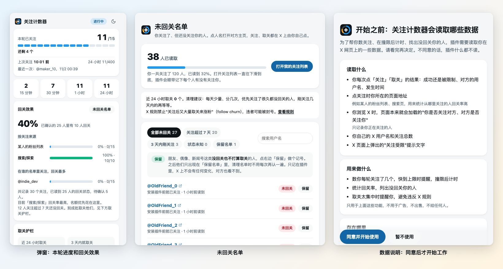

# 关注计数器 – 防撞限、查回关

一个 Chrome 插件，给在 X（原 Twitter）上靠关注别人起号的新手用：**数你每轮关注了几个，快到上限时提醒你歇一下，撞限后帮你算要等多久；还能找出你关注了、但没回关你的人。**

插件只记录、不替你操作：不会自动关注或取关。数据只存在你自己的电脑里，安装后要你看过数据说明并同意才开始工作。

> 本项目与 X Corp. 没有关联。名字里不带 X，是因为 X 的服务条款不允许未经书面同意使用 X / Twitter 的名称和商标。

[English summary](#english) · [隐私政策](PRIVACY.md)



## 能做什么

**关注计数和冷却计时**
- 页面左下角的浮标显示本轮进度格，一格一个名额，默认每轮 15 个，可以在弹窗里手动调整；快满时变琥珀色，满了提示歇一下。
- 每次成功关注，格子亮起、冒出「+1 @对方」，配一声音效；越接近满额，声音越重。
- 一轮满了没撞限：显示还要歇多久；距上次成功关注满 15 分钟，自动开始新一轮。
- 撞到 X 的限制后改为冷却计时，从本轮最后一次成功关注算起；撞过几次后，插件会总结出你的账号每轮大概能关注几个、要等多久，等够了弹系统通知。
- 工具栏图标上显示本轮个数，冷却中显示已等分钟数。

**回关追踪和未回关名单**
- 每次关注时记下你在哪个页面关注的（某人的粉丝列表、搜索、帖子回复区等），统计哪种来源回关率高。
- 打开自己的「正在关注」页面往下滑，没回关你的人会被标红；读到的人进入「未回关名单」页。
- 名单可按"关注超过 7 天""3 天内刚关注""状态未知"筛选、搜索、复制用户名；点人名打开对方主页，自己决定取不取关。
- 不打算取关的人（朋友、偶像、新闻号）点「保留」，之后不再出现在名单里。

**防违规提醒**
- 取关护栏：24 小时内取关太多、或刚关注几天就取关太多时提醒你。X 规则禁止"关注后又大量取关来涨粉"（follow churn）。
- 弹窗里有 X 官方限制卡片：每天 400 个关注、发帖和私信上限等，附官方来源。

**其他**：浅色 / 深色 / 跟随 X 三种外观；浮标可拖动；主页检查清单（头像、简介、置顶、横幅、活跃度）。

## 安装

还没有上架 Chrome 应用商店，目前从源码安装：

1. 下载本仓库（右上角 Code → Download ZIP，解压），或 `git clone`。
2. Chrome 打开 `chrome://extensions`，打开右上角「开发者模式」。
3. 点「加载已解压的扩展程序」，选仓库里的 `extension/` 文件夹。
4. 自动打开的数据说明页上点「同意并开始使用」，然后打开 x.com 正常关注即可。

## 隐私

- **同意之前什么都不读。** 读取网络响应的脚本默认关闭，页面上只显示一个"还没开始工作"的提示。
- **只读 X 页面上的这些数据：** 你关注、取关的结果和对方用户名，关注时所在的页面地址，页面已加载的"对方是否关注你"，你的用户名和关注总数，X 弹出的限制提示。
- **只存本机，不上传。** 插件不连接任何服务器，开发者看不到你的数据。
- **随时撤回：** 弹窗「设置」→「撤回同意」立即停止读取；「清空记录」删除数据；卸载插件删除全部数据。

完整说明见 [PRIVACY.md](PRIVACY.md)，在线版：<https://mikuairai.github.io/follow-counter/privacy/>。

## 关于"自动往下读"

关注列表页的面板里有一个「自动往下读」开关，**默认关闭**。X 的[自动化规则](https://help.x.com/en/rules-and-policies/x-automation)禁止用脚本操作 X 网页，违者可能被永久封号；自动往下读就是插件替你滚动页面。开启前插件会展示风险说明并要求确认。不开也一样能用：自己往下滑，效果相同。

## 工作原理

| 文件 | 作用 |
|---|---|
| `extension/inject.js` | 运行在 X 页面里，旁听 X 自己发出的关注 / 取关请求和用户资料响应，只读不改，不发新请求；同意前不读任何响应 |
| `extension/content.js` | 接收上面的事件并存到 `chrome.storage.local`；显示浮标、音效；X 改接口时从页面限制提示兜底记录 |
| `extension/following.js` | 「正在关注」页面上的标红和未回关筛选面板 |
| `extension/stats.js` | 轮次、冷却、回关率、取关护栏等全部计算，各处共用 |
| `extension/ui.js` | 进度组件，浮标和弹窗共用 |
| `extension/background.js` | 工具栏图标数字、解封通知、更新后注入已打开的 X 页面 |
| `extension/limits.js` | X 官方限制数据；X 改规则时只改这一个文件 |
| `extension/welcome.html` | 数据说明与同意页 |

冷却时长怎么测：等待时间从本轮最后一次成功关注算起。撞限后每隔 5–10 分钟试一次关注，失败时已等的时间是下限，第一次成功时已等的时间是上限，插件把区间记下来，越测越准。

## 已知限制

- **还没在真实 x.com 上全面验证。** X 网页的接口和页面结构没有公开文档，随时可能改；关注 / 取关的捕获、"对方是否关注你"的读取，都要装上后实际使用确认。遇到不准的情况欢迎提 Issue。
- 每轮 15 个和 15 分钟重置是作者实测和推测的默认值，X 没有公布；X 官方对"关注太快"的说法是"一小时左右后再试"。
- 只支持网页版 X，不支持手机 App。

## 开发

不需要构建，改完代码在 `chrome://extensions` 点插件的刷新按钮即可，插件会把新版注入已打开的 X 页面。

```bash
node tests/run.js   # 需要 Node.js 18+，没有其他依赖
```

测试覆盖统计和冷却计算、回关与取关护栏、同意前不读取、请求捕获（用模拟的 fetch / XHR）。

## 参与

欢迎提 Issue 和 Pull Request，见 [CONTRIBUTING.md](CONTRIBUTING.md)。特别需要：X 改版后接口或页面结构变化的报告。

## 许可

[MIT](LICENSE)

---

## English

**Follow Counter** is a Chrome extension for people growing an X (formerly Twitter) account by following others. It counts your follows per round, warns you before you hit X's follow limits, times the cooldown after you hit one, and lists accounts you follow that don't follow you back.

- It only records; it never follows or unfollows for you.
- Nothing is read until you agree to the in-extension data disclosure. All data stays in your browser's local storage and is never sent anywhere. See [PRIVACY.md](PRIVACY.md).
- The optional auto-scroll on the Following page is off by default and shows a warning first, because X's automation rules prohibit scripting the X website.
- Install: load the `extension/` folder via `chrome://extensions` → Developer mode → Load unpacked. Tests: `node tests/run.js`.
- UI text is in Chinese. Not affiliated with X Corp. Licensed under [MIT](LICENSE).
